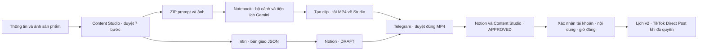

# Content Studio cá nhân

**Máy mới: [Cài đặt Windows, cấu hình và kiểm tra từng bước](docs/SETUP_WINDOWS.md).** Bộ cài giữ cấu hình có sẵn; hướng dẫn bao gồm Studio, n8n, Notion, Telegram và các điều kiện đăng TikTok.

**[Mở hệ thống và dùng từ đầu đến đăng riêng tư](docs/PERSONAL_STUDIO.md).** Phiên mới mặc định **Video thường**, người dùng duyệt cả lời kết Cảnh 4. Chọn **Video TikTok Shop** nếu cần mẫu chốt của Bảo; loại này chưa hỗ trợ đăng tự động. Gói mới dùng schema 2.1, giữ tương thích gói 2.0.


Content Studio giúp nhóm duyệt nội dung TikTok qua 7 bước, tạo gói prompt và ảnh tham chiếu, bàn giao nội dung vào Notion, rồi gửi đúng phiên bản MP4 để duyệt qua Telegram.

**[Duyệt MP4, kết nối TikTok và lập lịch](docs/TIKTOK_PUBLISHING_V2.md).** Bản dùng cá nhân mở trực tiếp trên máy, không cần đăng ký, mật khẩu hay tài khoản quản trị Content Studio. Bạn vẫn kết nối TikTok để cấp quyền đăng video. Ngày 21/11/2026, TikTok đã xác nhận đăng hai bài riêng tư qua Đăng ngay và Đặt lịch; hai bài đã xuất hiện nhưng còn lỗi phát cần đối chiếu, nên nghiệm thu chưa hoàn tất. Xem [biên bản tích hợp](docs/TIKTOK_INTEGRATION_STATUS.md). Ứng dụng chưa audit yêu cầu tài khoản riêng tư và video chọn **Chỉ mình tôi**.

Source nhánh `Automation` của Long đã có trong `main`. Đợt tích hợp này dùng lại ứng dụng TikTok đã bàn giao; không yêu cầu tạo ứng dụng mới ngay. Xem [đã tích hợp gì và điều kiện còn thiếu](docs/TIKTOK_INTEGRATION_STATUS.md).

**Bắt đầu từ [hướng dẫn sử dụng và bàn giao](docs/HANDOFF_CONTENT_STUDIO_V2.md).** Bài hướng dẫn có các bước chạy web, tạo clip, cấu hình Notion và Telegram, lấy caption, hashtag và bàn giao bản đã duyệt để đăng.



## Chạy web trên Windows

Cần Git, Python 3.12 hoặc 3.13 và khóa Gemini để sinh nội dung thật. Từ thư mục repo:

```powershell
python -m venv .venv
.\.venv\Scripts\python.exe -m pip install -r requirements.txt
if (!(Test-Path .env)) { Copy-Item .env.example .env }
# Điền GEMINI_API_KEY trong .env.
.\.venv\Scripts\python.exe run_server.py
```

Mở [Content Studio ở cổng 8001](http://127.0.0.1:8001/app). Docker Desktop cần cho phần automation. Để thử giao diện bằng dữ liệu giả lập, chạy `.\.venv\Scripts\python.exe -m tests.preview_studio` rồi mở [cổng 8002](http://127.0.0.1:8002/app).

| Cần làm | Tài liệu |
|---|---|
| Sử dụng web từ đầu đến lúc bàn giao đăng bài | [Hướng dẫn Content Studio v2](docs/HANDOFF_CONTENT_STUDIO_V2.md) |
| Cài Automation, n8n, Notion và bot Telegram | [Cấu hình automation v2](integrations/long-v2/README.md) |
| Tích hợp API hoặc sửa hệ thống | [API và cấu trúc dữ liệu](docs/CONTENT_STUDIO_V2.md) |
| Đối chiếu nghiệm thu SEJOY và chạy kiểm thử | [Runbook SEJOY](docs/SEJOY_ACCEPTANCE_RUNBOOK.md) |
| Điền prompt vào chat Gemini trên Chrome/Edge | [Cài tiện ích Gemini](extensions/gemini/README.md) |
| Theo dõi bản hợp nhất và cách cập nhật source | [Đồng bộ các nhánh](docs/REPOSITORY_SYNC.md) |
| Kế hoạch trợ lý chat trong Content Studio | [Kế hoạch chatbox](docs/CHATBOX_PLAN.md) |
| Hỏi đáp theo sản phẩm và bước đang làm | [Dùng trợ lý theo phiên](docs/CHATBOX.md) |
| Xem ZIP và JSON mẫu | [Dữ liệu tổng hợp](examples/handoff-v2/README.md) |
| Vận hành tích hợp cũ | [Pipeline v1](docs/LEGACY_PIPELINE_V1.md) |

Cấu hình thật nằm trong `.env` trên máy chạy. GitHub chứa cấu hình mẫu, dữ liệu tổng hợp và mã nguồn. Phiên làm việc, ảnh tải lên, MP4, bản xuất và biên nhận thật được lưu riêng.

## Source hợp nhất và kiểm thử

Clone nhánh `main` để có web, bộ đầu vào Notebook, tiện ích Gemini và Automation v2 trong cùng repo. Các phần tiếp tục dùng chung mã phiên, revision bundle và SHA-256 khi bàn giao. Không cần ghép file từ các nhánh cũ.

Cần Node.js 20 trở lên để kiểm tra tiện ích và việc chuyển JSON qua n8n. Từ gốc repo:

```powershell
.\.venv\Scripts\python.exe -m pip install -r requirements-test.txt
.\.venv\Scripts\python.exe scripts/verify.py
```

Lệnh chạy kiểm thử web, API v1/v2, Automation, Notebook, tiện ích, trợ lý chat, tài khoản và lịch đăng bằng dữ liệu giả lập. GitHub Actions chạy cùng lệnh trên Windows và Linux. Lượt tạo video vẫn thực hiện trong Gemini. Chủ tài khoản xem và duyệt MP4, cấp quyền TikTok rồi xác nhận từng lượt đăng/lịch. Trợ lý chat hiện hỗ trợ hỏi đáp theo phiên; áp dụng đề xuất sửa nội dung là mốc tiếp theo.
