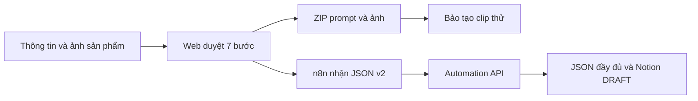

# Content Studio v2 — AI Content & TikTok Automation

Web tiếng Việt để nhập sản phẩm, duyệt nội dung theo **7 bước** và xuất prompt cho **4 hoặc 5 cảnh, mỗi cảnh dự kiến 8 giây**. Có lịch sử phiên, ảnh tham chiếu và bộ dữ liệu bàn giao cho automation.

**Bảo và Long bắt đầu tại [Bài hướng dẫn bàn giao và chạy thử](docs/HANDOFF_CONTENT_STUDIO_V2.md).** Bài giải thích nguyên lý, cách cài đặt, việc của từng người và điều kiện nghiệm thu.



Ứng dụng hiện chuẩn bị nội dung và bàn giao. Chưa tích hợp tạo video, ghép MP4, bot Telegram hoặc đăng TikTok.

## Chạy nhanh trên Windows

Cần Python 3.12 hoặc 3.13, Git và API key Gemini của riêng bạn. Từ thư mục repo:

```powershell
python -m venv .venv
.\.venv\Scripts\python.exe -m pip install -r requirements-test.txt
if (!(Test-Path .env)) { Copy-Item .env.example .env }
# Điền GEMINI_API_KEY trong .env; giữ các cấu hình khác theo hướng dẫn.
.\.venv\Scripts\python.exe run_server.py
```

Mở [Content Studio](http://127.0.0.1:8001/app). URL localhost chỉ dùng trên máy đang chạy server.

Muốn xem giao diện bằng AI giả lập trước khi có key: chạy `.\.venv\Scripts\python.exe -m tests.preview_studio` và mở cổng **8002**. Đây là chế độ kiểm thử, dữ liệu tách riêng và không phải kết quả AI thật.

## Tài liệu và source

| Nội dung | Đường dẫn |
|---|---|
| Bài chính cho nhóm | [Bàn giao Content Studio v2](docs/HANDOFF_CONTENT_STUDIO_V2.md) |
| API và quy trình web | [Content Studio v2](docs/CONTENT_STUDIO_V2.md) |
| Source automation đóng gói | [Tích hợp v2 cho Long](integrations/long-v2/README.md) |
| Mẫu dữ liệu tổng hợp | [Ví dụ gói v2](examples/handoff-v2/README.md) |
| Kiểm chứng SEJOY và bước tiếp theo | [Runbook nghiệm thu](docs/SEJOY_ACCEPTANCE_RUNBOOK.md) |
| Bằng chứng kiểm thử | [Trạng thái triển khai](docs/IMPLEMENTATION_STATUS_V2.md) |
| API tự động cũ | [Pipeline v1](docs/LEGACY_PIPELINE_V1.md) |
| Mẫu tin nhắn gửi nhóm | [Tin nhắn bàn giao](docs/TEAM_MESSAGE.md) |

`POST /generate` và callback v1 vẫn hoạt động độc lập. Bộ dữ liệu từng cảnh của web dùng endpoint **v2**.

Phiên, lịch sử, ảnh tải lên và ZIP thật nằm trong `data/`, được loại khỏi Git. Mỗi máy giữ `.env` riêng; repo chỉ chứa cấu hình mẫu. Tài liệu ghi riêng kiểm thử giả lập, kiểm tra AI thật và nghiệm thu với nhóm.
