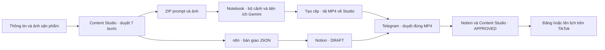

# Content Studio v2

Content Studio giúp nhóm duyệt nội dung TikTok qua 7 bước, tạo gói prompt và ảnh tham chiếu, bàn giao nội dung vào Notion, rồi gửi đúng phiên bản MP4 để duyệt qua Telegram.

**Bắt đầu từ [hướng dẫn sử dụng và bàn giao](docs/HANDOFF_CONTENT_STUDIO_V2.md).** Bài hướng dẫn có các bước chạy web, tạo clip, cấu hình Notion và Telegram, lấy caption, hashtag và bàn giao bản đã duyệt để đăng.



## Chạy web trên Windows

Cần Git, Python 3.12 hoặc 3.13 và khóa Gemini để sinh nội dung thật. Từ thư mục repo:

```powershell
python -m venv .venv
.\.venv\Scripts\python.exe -m pip install -r requirements.txt
if (!(Test-Path .env)) { Copy-Item .env.example .env }
# Điền GEMINI_API_KEY trong .env.
.\.venv\Scripts\python.exe run_server.py
```

Mở [Content Studio ở cổng 8001](http://127.0.0.1:8001/app). Docker Desktop cần cho phần automation. Để thử giao diện bằng dữ liệu giả lập, chạy `.\.venv\Scripts\python.exe -m tests.preview_studio` rồi mở [cổng 8002](http://127.0.0.1:8002/app).

| Cần làm | Tài liệu |
|---|---|
| Sử dụng web từ đầu đến lúc bàn giao đăng bài | [Hướng dẫn Content Studio v2](docs/HANDOFF_CONTENT_STUDIO_V2.md) |
| Cài Automation, n8n, Notion và bot Telegram | [Cấu hình automation v2](integrations/long-v2/README.md) |
| Tích hợp API hoặc sửa hệ thống | [API và cấu trúc dữ liệu](docs/CONTENT_STUDIO_V2.md) |
| Đối chiếu nghiệm thu SEJOY và chạy kiểm thử | [Runbook SEJOY](docs/SEJOY_ACCEPTANCE_RUNBOOK.md) |
| Điền prompt vào chat Gemini trên Chrome/Edge | [Cài tiện ích Gemini](extensions/gemini/README.md) |
| Theo dõi bản hợp nhất và cách cập nhật source | [Đồng bộ các nhánh](docs/REPOSITORY_SYNC.md) |
| Kế hoạch trợ lý chat trong Content Studio | [Kế hoạch chatbox](docs/CHATBOX_PLAN.md) |
| Xem ZIP và JSON mẫu | [Dữ liệu tổng hợp](examples/handoff-v2/README.md) |
| Vận hành tích hợp cũ | [Pipeline v1](docs/LEGACY_PIPELINE_V1.md) |

Cấu hình thật nằm trong `.env` trên máy chạy. GitHub chứa cấu hình mẫu, dữ liệu tổng hợp và mã nguồn. Phiên làm việc, ảnh tải lên, MP4, bản xuất và biên nhận thật được lưu riêng.

## Bản dùng chung và kiểm thử

Clone nhánh `main` để có web, bộ đầu vào Notebook, tiện ích Gemini và Automation v2 trong cùng repo. Các phần tiếp tục dùng chung mã phiên, revision bundle và SHA-256 khi bàn giao. Không cần ghép file từ các nhánh cũ.

Cần Node.js 20 trở lên để kiểm tra tiện ích và việc chuyển JSON qua n8n. Từ gốc repo:

```powershell
.\.venv\Scripts\python.exe -m pip install -r requirements-test.txt
.\.venv\Scripts\python.exe scripts/verify.py
```

Lệnh chạy kiểm thử web, API v1/v2, Automation, Notebook và tiện ích bằng dữ liệu giả lập. GitHub Actions chạy cùng lệnh trên Windows và Linux. Lượt tạo video vẫn thực hiện trong Gemini; việc xuất bản TikTok cần thao tác của chủ tài khoản. Trợ lý chat đang ở giai đoạn thiết kế.
