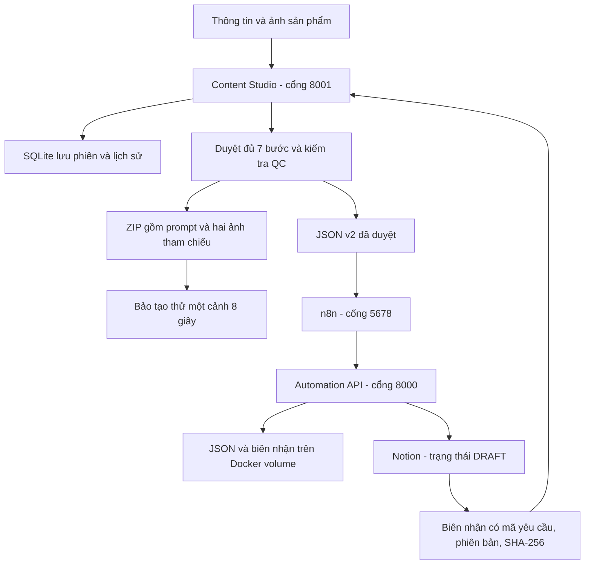
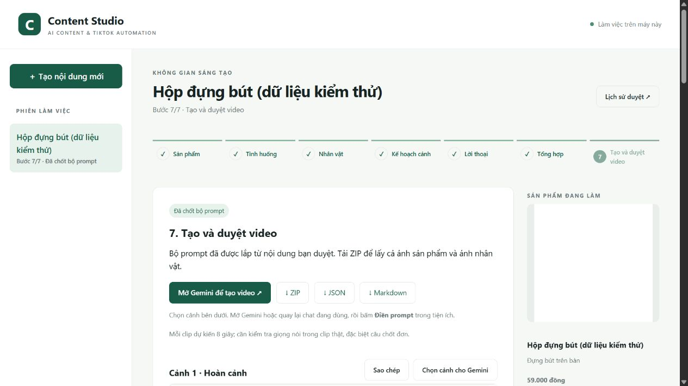

# Bàn giao Content Studio v2 — hướng dẫn cho Bảo và Long

> Ngày cập nhật: 05/11/2026. Mục tiêu của đợt này là giúp nhóm chạy thử cùng một phiên bản source và nghiệm thu bộ prompt. Phần bot Telegram nằm ngoài phạm vi đợt này.

Bản source bàn giao nằm trên nhánh `docs/content-studio-v2-handoff`; xem và góp ý tại [PR #1](https://github.com/QuanPhan78/AI-Tiktok/pull/1). Chưa merge vào `main`.

## 1. Hệ thống hiện làm được gì?

Người dùng nhập sản phẩm và ảnh, AI đề xuất nội dung, người dùng duyệt từng bước. Sau cùng, chương trình lắp prompt từ dữ liệu đã duyệt và xuất JSON/Markdown/ZIP. AI không được tự viết lại lời thoại đã chốt ở bước xuất.



Web chưa gọi API tạo video, chưa dựng MP4 và chưa đăng TikTok. Chốt prompt không phải quyết định duyệt một video để đăng. QC là kiểm tra nội bộ, không phải chứng nhận tuân thủ của TikTok.

| Mốc | Bằng chứng hiện có |
|---|---|
| Backend, giao diện và automation v2 | Source nằm trong repo này, gồm gói tích hợp riêng cho Long |
| Kiểm thử | 119 bài tự động đã đạt trước đợt đóng gói; phần xác minh bản bàn giao nằm trong [trạng thái triển khai](IMPLEMENTATION_STATUS_V2.md) |
| SEJOY thật | Bộ xuất revision 26, bốn cảnh, Gemini QC 9/10; đã tải ZIP đủ prompt và hai ảnh, đối chiếu nội dung giữ nguyên |
| Bàn giao SEJOY | Phiên revision 27 ghi nhận lần gửi lỗi kết nối, chưa có biên nhận; bundle vẫn là revision 26 |
| Video và đăng bài | Chưa có clip thử được nhóm xác nhận, chưa đăng TikTok |

Revision của phiên tăng theo thao tác; revision của bundle là bản nội dung đã chốt. Khi đối chiếu bàn giao phải dùng revision trong `handoff.json` và biên nhận, không lấy số phiên sau một lần gửi lỗi.

## 2. Cài và mở web

Khuyến nghị Python **3.12 hoặc 3.13**. Python 3.14 trên máy phát triển chạy được bộ test nhưng LangChain còn cảnh báo tương thích Pydantic V1. Cần Git; Docker Desktop chỉ cần khi thử phần automation. Các lệnh dưới dùng PowerShell trên Windows.

```powershell
git clone https://github.com/QuanPhan78/AI-Tiktok.git
cd AI-Tiktok
# Trong lúc PR chưa merge, lấy đúng nhánh bàn giao:
git switch docs/content-studio-v2-handoff
python -m venv .venv
.\.venv\Scripts\python.exe -m pip install -r requirements-test.txt
if (!(Test-Path .env)) { Copy-Item .env.example .env }
```

Điền key của chính máy đang chạy vào `.env`. Chỉ cần Gemini cho web; credential Notion đặt trong thư mục automation. Cấu hình web dùng:

```dotenv
GEMINI_API_KEY=your_gemini_api_key
GEMINI_MODEL=gemini-3.1-flash-lite
GEMINI_FALLBACK_MODEL=gemini-3.5-flash-lite
HOST=127.0.0.1
PORT=8001
ENABLE_NGROK=0
WEBHOOK_V2_URL=http://127.0.0.1:5678/webhook/ai-agent-callback-v2
WEBHOOK_V2_TOKEN=your_shared_random_token
```

Đây là tên model đã dùng thành công trong lần kiểm tra; quyền truy cập và hạn mức tùy tài khoản API. Nếu model không khả dụng, chọn model tài khoản có quyền qua biến môi trường. Không sao chép key vào bài, source hoặc nhóm chat.

```powershell
.\.venv\Scripts\python.exe run_server.py
```

Mở [web cổng 8001](http://127.0.0.1:8001/app). Phiên được lưu dưới `data/`, mở lại trình duyệt hoặc server vẫn tiếp tục được. Repo clone mới không chứa phiên SEJOY của máy phát triển.

Muốn xem luồng bằng dữ liệu giả lập, chạy lệnh dưới trong một cửa sổ riêng rồi mở [web QA cổng 8002](http://127.0.0.1:8002/app):

```powershell
.\.venv\Scripts\python.exe -m tests.preview_studio
```

Chế độ này không gọi Gemini/đọc link sản phẩm để sinh nội dung. Dùng sản phẩm tổng hợp trong [mẫu v2](../examples/handoff-v2/README.md); không coi kết quả QA là nghiệm thu AI thật và không bấm gửi vào Notion đang dùng. Cổng 8001 vẫn là luồng thật.



## 3. Duyệt đủ 7 bước

| Bước | Người dùng làm gì? | Điều kiện tiếp tục |
|---|---|---|
| 1. Sản phẩm | Nhập tên, công dụng đã xác nhận, giá, link và ảnh; kiểm tra tóm tắt | Xác nhận thông tin, không biến gợi ý chưa kiểm chứng thành sự thật |
| 2. Tình huống | Chọn một trong bốn đề xuất hoặc tự nhập | Chốt một tình huống |
| 3. Nhân vật | Chọn NV1–NV8 hoặc nhân vật mới có ảnh; chọn nói trực tiếp/thuyết minh | Chốt nhân vật và giọng |
| 4. Kế hoạch cảnh | Chọn bốn cảnh hoặc tách cảnh 3 thành 3A/3B để có năm cảnh | Duyệt hành động và phong cách |
| 5. Lời thoại | Duyệt lần lượt từng cảnh | Giữ nguyên câu chốt cuối cố định |
| 6. Tổng hợp | Kiểm tra hai bảng, 5 slogan, 3 caption, hashtag, bình luận ghim và chữ dựng | Chọn caption; QC từ 8/10, không còn lỗi chặn, đủ dữ liệu |
| 7. Xuất prompt | Sao chép từng prompt hoặc tải JSON/Markdown/ZIP | Chỉ mở khi Bước 6 đạt |

Bốn cảnh dự kiến tổng 32 giây, năm cảnh dự kiến 40 giây trước khi dựng/cắt. Thời lượng thực phải đo trên clip; độ dài lời thoại và câu chốt được cảnh báo, không cam kết đọc vừa 8 giây.

Giá dùng khi dựng và link dùng khi đăng được giữ nguyên, không đưa vào lời thoại/prompt video. Sửa bước trước hủy xác nhận các bước phụ thuộc và giữ lịch sử. QC hiện gần nút chốt, nêu trường/cảnh cùng trích đoạn nếu chặn; lời nhắc phong cách/độ dài không tự chặn. Lỗi AI hoặc kết nối giữ bản sửa đã gửi, không âm thầm sửa lời thoại.

## 4. Bảo nhận gì và thử thế nào?

Nhận **ZIP xuất từ Bước 7**, gồm `handoff.json`, `prompts.md`, `product.*`, `character.*`. ZIP SEJOY thật gửi riêng trong nhóm; mẫu trong GitHub là dữ liệu tổng hợp, không phải ảnh/sản phẩm SEJOY đã xác nhận.

1. Kiểm tra ảnh sản phẩm đúng biến thể và ảnh nhân vật. Ảnh SEJOY nguồn còn có chữ quảng cáo/chứng nhận chưa xác minh; cần xác nhận hoặc thay ảnh phù hợp trước khi dùng.
2. Mở `prompts.md`, lấy **nguyên prompt Cảnh 2**, đính kèm cả hai ảnh và tạo một clip 8 giây trong công cụ đang dùng. Nếu chọn chế độ thuyết minh thì lời thoại đi riêng khi dựng.
3. Trả lại clip gốc cùng nhận xét về sản phẩm, nhân vật, lời thoại, nhịp đọc, lỗi hình ảnh và watermark nếu có. Ghi rõ request_id, bundle revision và mã cảnh.
4. Cần sửa thì báo đúng cảnh: hành động/phong cách sửa ở Bước 4, lời thoại sửa ở Bước 5; duyệt lại các phần phụ thuộc rồi xuất bản mới. Không chỉnh prompt ngoài bản được quản lý.

Một cảnh thử đạt chưa chứng minh toàn video hoặc câu chốt cuối đã vừa thời lượng. Biến thể, giá khi đăng và giỏ TikTok Shop còn phải kiểm tra thực tế.

## 5. Long nhận gì và chạy thế nào?

Source nằm trong [gói automation v2](../integrations/long-v2/README.md). Có thể chạy ngay trên cùng máy web để kiểm tra trước; Docker Compose phục vụ n8n cổng **5678**, API cổng **8000**. Header Auth phải khớp `WEBHOOK_V2_TOKEN` của web.

| Trường hợp | Cấu hình đích trên web |
|---|---|
| Web và Docker cùng máy | `http://127.0.0.1:5678/webhook/ai-agent-callback-v2` |
| Web và automation khác máy | URL HTTPS production của webhook v2 do máy automation cung cấp; giữ Header Auth |

`127.0.0.1` luôn chỉ chính máy đang gọi. Không gửi địa chỉ này cho máy khác rồi coi như liên kết nhóm. Khi khác máy chỉ cần mở webhook có xác thực, không mở toàn bộ giao diện web/n8n ra Internet.

Các bước chi tiết, schema Notion thử và lệnh chạy có trong README gói tích hợp. Luồng nhận là:

1. Web kiểm tra bản chốt, gửi nguyên JSON v2 qua n8n, không gọi AI viết lại.
2. n8n chuyển toàn bộ payload tới `POST /api/v2/content/ai-output`.
3. API lưu JSON và tiến độ trên Docker volume, ghi Notion ở trạng thái **DRAFT**. Prompt dài nằm trong thân trang và được chia block.
4. Web chỉ báo nhận thành công khi biên nhận khớp `request_id`, `revision`, `payload_sha256`.
5. Long đọc lại `GET /api/v2/content/{request_id}/revisions/{revision}` và đối chiếu toàn bộ dữ liệu, kể cả sau restart.

Ảnh không được upload qua callback JSON; metadata chứa tên, dung lượng và SHA-256. Bảo nhận ảnh trong ZIP. Gửi lại cùng bản không tạo trang/section trùng. Nội dung đã sang duyệt video/lập lịch/đăng không được ghi đè bằng bản mới.

**V1 khác v2:** webhook v1 `/webhook/ai-agent-callback` nhận `ai_result` của pipeline cũ. Web 7 bước gửi `scenes[]`, nhân vật và publishing qua webhook **`ai-agent-callback-v2`**; không đổi URL sang v1 để thử vượt lỗi.

## 6. Lỗi thường gặp

| Hiện tượng | Kiểm tra và xử lý |
|---|---|
| Gemini 503/504 | Lỗi dịch vụ tạm thời; server có retry/fallback giới hạn. Thử lại sau; đổi key không bảo đảm hết quá tải |
| Gemini 401/403/429 | Kiểm tra key, quyền model, hạn mức và cấu hình tài khoản; không lặp vô hạn |
| QC chưa cho xuất | Đọc bảng ngay trên nút chốt; sửa đúng trường/cảnh có bằng chứng. Không ép điểm hoặc sửa câu chốt cố định vì phong cách |
| Thiếu ảnh hoặc ảnh thay đổi | Kiểm tra ảnh sản phẩm ở Bước 1, nhân vật ở Bước 3 rồi duyệt lại |
| Docker không kết nối | Mở Docker Desktop, đợi engine sẵn sàng; kiểm tra `docker info` |
| Webhook ConnectError/404 | Kiểm tra Docker, workflow đã bật, URL production `/webhook/…` và đúng cổng; `/webhook-test/…` không dùng để bàn giao thường xuyên |
| Webhook 401/403 | Credential Header Auth phải có header `X-Content-Token`, khớp cấu hình phía web |
| Notion 503/502 | Kiểm tra database thử, quyền integration, đúng schema; 502 có thể đã lưu một phần, gửi lại nguyên bundle để tiếp tục |
| Gửi không thành công | Bundle đã chốt vẫn còn để tải/gửi lại; chỉ ghi nhận thành công khi có biên nhận hợp lệ |

## 7. Kiểm thử và nghiệm thu

Từ gốc repo, dùng lệnh trong [trạng thái triển khai](IMPLEMENTATION_STATUS_V2.md) để chạy suite tự động không gọi AI/Notion thật. Kiểm thử gồm 4/5 cảnh, bảo toàn lời thoại, QC cảnh báo/lỗi, API v1, gửi trùng, prompt dài và lưu lại sau lỗi. Không dùng `test_live_e2e_pipeline.py` để thay cho suite giả lập.

Nghiệm thu cùng nhóm còn cần: Bảo xác nhận clip thử; Long có biên nhận và readback khớp bản xuất, dữ liệu tồn tại sau restart. Xem [runbook SEJOY](SEJOY_ACCEPTANCE_RUNBOOK.md). Câu chốt đang nhắc TikTok Shop nên chỉ dùng nội bộ cho đến khi nhóm xác nhận sản phẩm có trong giỏ tương ứng.

Trước khi báo đạt, ghi đủ ba kết quả: **bộ prompt dùng được**, **clip thử dùng được**, **bản nhận khớp bản duyệt**. Source và bài hướng dẫn không thay thế các bằng chứng này.
